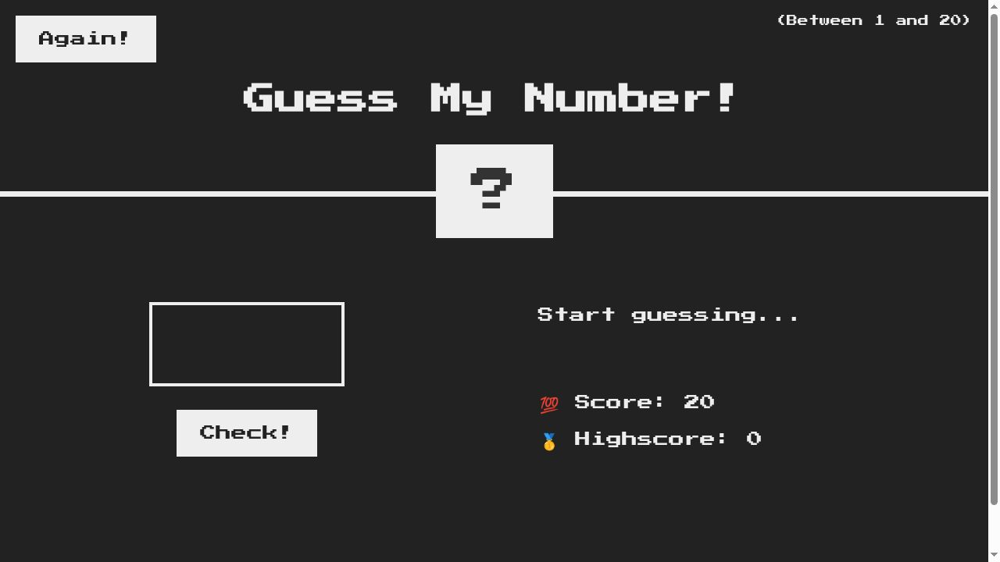

# Guess My Number

A small browser game: the computer picks a number between 1 and 20, you guess it, and it tells you whether you are too high or too low until you find it.

**Play it:** https://mhmd7710d.github.io/Guess-My-Number-Game/

## How to play
1. Type a number from 1 to 20 and press **Check!**
2. The game says too high or too low, and every wrong guess costs one point.
3. Find the number before the score reaches 0. The best score stays while the page is open; **Again!** starts a new round.

## Built with
Plain HTML, CSS and JavaScript. No libraries and no build step.

## What I practised
Reading input and turning it into a number, `if`/`else` logic, changing the page from JavaScript, keeping state (score and high score), and a layout that works on a phone.

## Run it locally
Download the repository and open `index.html` in any browser.

## Credits
A learning project based on Jonas Schmedtmann's Complete JavaScript Course.

## Contact
- LinkedIn: https://www.linkedin.com/in/muhammad-fathi-b7a693424/
- X (Twitter): https://x.com/mouahid7710
- Facebook: https://www.facebook.com/share/1CQhxpCeYL/
- Instagram: https://www.instagram.com/mhmd7710d/
- Email: muhammutfathi@gmail.com
- WhatsApp: https://wa.me/201040428475?text=Hi+Mohammad%2C+I+found+your+project+on+GitHub.
